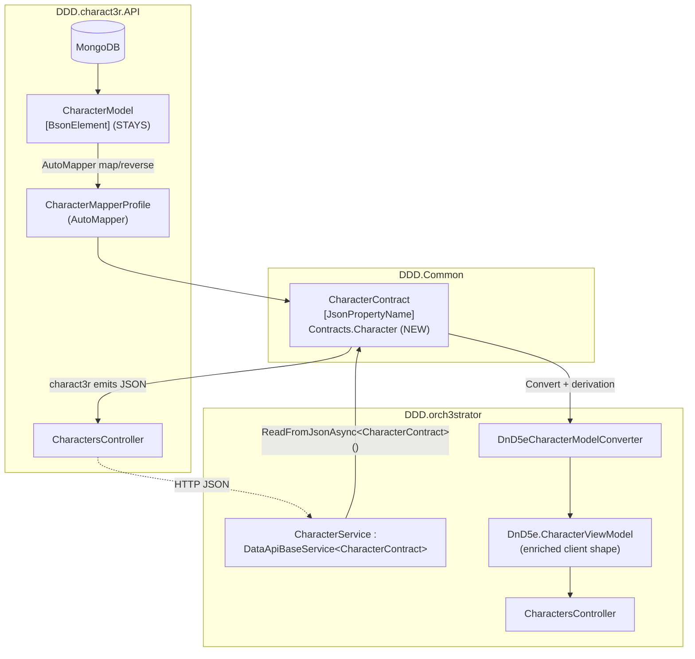
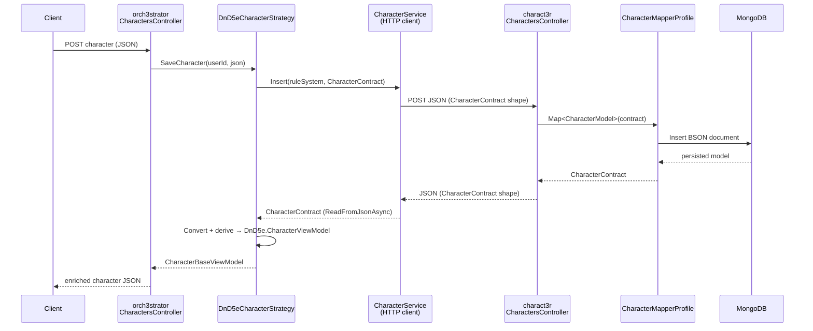

# Design Document: shared-character-contract

## Overview

The 3ncount3r backend defines the character JSON *wire contract* twice: once in
`DDD.charact3r.API.ViewModels.CharacterViewModel` (the shape charact3r emits) and
again in `DDD.orch3strator.Models.CharacterService.CharacterModel` (the shape the
orchestrator deserializes that JSON into). Because these two classes are
hand-maintained independently, they drift: when one side gains a field and the
other does not, the missing field silently deserializes to `null`. This is the
likely cause of the currently commented-out class/race mapping in
`DnD5eCharacterModelConverter`.

This feature extracts a single canonical wire contract, `CharacterContract`, into
the shared `DDD.Common` library and repoints both consumers at it. The change is a
pure refactor of a serialization concern: the JSON on the wire is unchanged, no
MongoDB documents move, and no API response shape changes. The only observable
outcome is that the two sides can no longer drift — a field added to the contract
appears on both ends at compile time, and a rename or removal becomes a compile
error instead of a runtime `null`.

The persistence model (`DDD.charact3r.API.Models.CharacterModel`, the
`[BsonElement]`-annotated MongoDB shape) is genuinely charact3r-owned and stays
put. Only the middle hop of the pipeline — the duplicated wire contract — is
de-duplicated. The orchestrator's outward, enriched, client-facing
`DnD5e.CharacterViewModel` is a distinct type and is deliberately **not**
collapsed into the contract.

---

## Architecture

### The three character types (only two duplicate)

| # | Type | Attributes | Role | Disposition |
|---|------|-----------|------|-------------|
| 1 | `DDD.charact3r.API.Models.CharacterModel` | `[BsonElement]` | MongoDB persistence shape | **Stays** — charact3r-owned |
| 2 | `DDD.charact3r.API.ViewModels.CharacterViewModel` | `[JsonPropertyName]` | JSON charact3r **emits** | **Deleted** → shared `CharacterContract` |
| 3 | `DDD.orch3strator.Models.CharacterService.CharacterModel` | `[JsonPropertyName]` | JSON the orchestrator **deserializes** | **Deleted** → shared `CharacterContract` |

Types 2 and 3 describe the same bytes on the wire from opposite ends. That is the
duplication that drifts. Type 1 is a separate concern (BSON persistence) and is
left untouched.

### Component view



`DDD.charact3r.API` and `DDD.orch3strator` **already** reference `DDD.Common`
(verified in both `.csproj` files). The shared contract therefore introduces **no
new project references** and no coupling beyond what already exists implicitly.

### Three-hop pipeline (preserved)

```
Mongo CharacterModel
  --(charact3r AutoMapper: CharacterMapperProfile)-->
CharacterContract                                  [shared, DDD.Common]
  --(charact3r emits JSON  →  orchestrator ReadFromJsonAsync)-->
CharacterContract                                  [same shared type, both ends]
  --(DnD5eCharacterModelConverter + CharacterDerivationCalculator)-->
DnD5e.CharacterViewModel                           (enriched, client-facing)
```

Only the middle hop is de-duplicated. The persistence boundary (hop 1) and the
derivation/enrichment boundary (hop 3) are unchanged.

### Data-flow sequence (write then read-back)



---

## Components and Interfaces

### Component 1: `CharacterContract` (new, in `DDD.Common`)

**Purpose**: The single canonical `[JsonPropertyName]`-annotated wire contract
exchanged between charact3r (producer) and the orchestrator (consumer). It is the
merged, complete shape — it carries every field either side previously had,
including the recently added `proficiencies` and `spellcasting` blocks and the
extended class fields (`subclass`, `isPrimaryClass`, `casterType`, `hitDie`).

**Home**: new namespace `DDD.Common.Contracts.Character`, single file
`DDD.Common/Contracts/Character/CharacterContract.cs` (mirrors the existing
single-file-with-nested-types convention of `CharacterModel.cs`).

**Responsibilities**:
- Define the referential wire shape (source-of-truth fields and `byoapiId`
  pointers only — no derived values).
- Serve as both the type charact3r's AutoMapper profile maps *to* and the type
  the orchestrator's `ReadFromJsonAsync<T>()` deserializes *into*.
- Own all nested contract types (class, race, hitpoint, movement speed, bonus,
  feat, equipment, proficiency, skill proficiency, spellcasting, spellcasting
  class, spell ref, slot tracker, pact magic).

**Interface** (shape sketch — full field list in the Data Models section):

```csharp
namespace DDD.Common.Contracts.Character
{
  public class CharacterContract
  {
    [JsonPropertyName("id")]             public string Id { get; set; }
    [JsonPropertyName("userId")]         public string UserId { get; set; }
    [JsonPropertyName("name")]           public string Name { get; set; }
    [JsonPropertyName("ruleSystem")]     public string RuleSystem { get; set; }
    // ... full merged shape, nested types below
  }
}
```

### Component 2: `CharacterMapperProfile` (modified, in `DDD.charact3r.API`)

**Purpose**: Map the BSON persistence model to/from the shared contract.

**Change**: Every `CreateMap<..Model, ..ViewModel>()` pair becomes
`CreateMap<..Model, ..Contract>()`. The `ObjectId` ↔ `string` id handling on the
reverse map is preserved unchanged.

**Responsibilities**:
- Map `CharacterModel` (BSON) ↔ `CharacterContract` and all nested pairs.

### Component 3: charact3r `CharactersController` (modified)

**Purpose**: Emit the contract as JSON.

**Change**: Action return types and the POST/PUT body parameter type change from
`CharacterViewModel` to `CharacterContract`. `_mapper.Map<CharacterContract>(...)`
and `_mapper.Map<CharacterModel>(contract)` replace the view-model calls. Behavior
and routes are unchanged.

### Component 4: orchestrator `CharacterService` + `DataApiBaseService<T>` usages (modified)

**Purpose**: HTTP-deserialize downstream charact3r responses.

**Change**: `DataApiBaseService<CharacterModel>` becomes
`DataApiBaseService<CharacterContract>` everywhere it appears. This is **not a
single site** — the orchestrator's `CharacterModel` is consumed by:
- `Services/CharacterService.cs` (`: DataApiBaseService<CharacterModel>`)
- `Program.cs` DI registration
- `Strategies/Characters/DnD5eCharacterStrategy.cs`
- `Strategies/Encounters/DnD5eEncounterStrategy.cs`
- `Strategies/Parties/DnD5ePartyStrategy.cs`
- `Converters/DnD5eCharacterModelConverter.cs` (input type)

All six must be repointed. The compiler enumerates any that are missed.

### Component 5: `DnD5eCharacterModelConverter` (modified)

**Purpose**: Convert the deserialized contract into the enriched
`DnD5e.CharacterViewModel`.

**Change**: Input type `CharacterModel` → `CharacterContract`. The
previously commented-out class/race mapping is **re-enabled** now that the
contract reliably carries `Classes` and `Race`. `Convert`, `ConvertReverse`, and
`Map` signatures otherwise keep their behavior.

### Component boundary that does NOT change

`DnD5e.CharacterViewModel` (orchestrator, `ViewModels.DnD5e`) remains the enriched,
derived, client-facing shape (flat attributes, computed HP/AC/DCs). It is distinct
from `CharacterContract` and is not merged. Keeping them separate avoids a
same-name-different-type trap and preserves the derivation boundary described in
the rules doc §16–§17.

---

## Data Models

`CharacterContract` is the merged union of the two deleted types. It follows the
C# backend standards: `net8.0`, `System.Text.Json`, `[JsonPropertyName]` in
camelCase, single-file nested types. The complete field-level detail (types,
ranges, semantics) lives in `docs/dnd-5e-character-sheet-rules.md` §15–§17; the
authoritative shape is reproduced here.

### `CharacterContract`

```csharp
using System.Text.Json.Serialization;

namespace DDD.Common.Contracts.Character
{
  public class CharacterContract
  {
    [JsonPropertyName("id")]             public string Id { get; set; }
    [JsonPropertyName("userId")]         public string UserId { get; set; }
    [JsonPropertyName("name")]           public string Name { get; set; }
    [JsonPropertyName("ruleSystem")]     public string RuleSystem { get; set; }
    [JsonPropertyName("size")]           public IEnumerable<string> Size { get; set; }
    [JsonPropertyName("race")]           public RaceContract Race { get; set; }
    [JsonPropertyName("classes")]        public IEnumerable<CharacterClassContract> Classes { get; set; }
    [JsonPropertyName("hitpoints")]      public IEnumerable<HitpointContract> Hitpoints { get; set; }
    [JsonPropertyName("movementSpeeds")] public IEnumerable<MovementSpeedContract> MovementSpeeds { get; set; }

    // Ability scores: str/dex/con/int/wis/cha → score. Serialized as-is.
    public Dictionary<string, int> Attributes { get; set; }

    [JsonPropertyName("bonuses")]        public IEnumerable<BonusContract> Bonuses { get; set; }
    [JsonPropertyName("proficiencies")]  public ProficiencyContract Proficiencies { get; set; }
    [JsonPropertyName("spellcasting")]   public SpellcastingContract Spellcasting { get; set; }
    [JsonPropertyName("languages")]      public IEnumerable<string> Languages { get; set; }
    [JsonPropertyName("feats")]          public IEnumerable<FeatContract> Feats { get; set; }
    [JsonPropertyName("inventory")]      public IEnumerable<EquipmentContract> Inventory { get; set; }
  }
}
```

**Validation / invariants (contract-level):**
- The contract stores *source-of-truth* fields only; derived values (ability
  modifiers, proficiency bonus, AC, save/skill mods, spell DCs, combined caster
  level, slot maxima) are never present here.
- Optional blocks (`Proficiencies`, `Spellcasting`, `Race`) may be `null` when the
  character has no such data. `Spellcasting` is absent for non-casters.
- References (`race`, `classes`, `feats`, spell/inventory entries) carry
  `byoapiId` pointers; the stat blocks live in the BYOAPI, not the contract.

### Nested contract types

```csharp
public class CharacterClassContract
{
  [JsonPropertyName("id")]             public string Id { get; set; }
  [JsonPropertyName("level")]          public int Level { get; set; }
  [JsonPropertyName("byoapiId")]       public string ByoapiId { get; set; }
  [JsonPropertyName("subclass")]       public string Subclass { get; set; }
  [JsonPropertyName("isPrimaryClass")] public bool IsPrimaryClass { get; set; }
  // full | half | third | pact | none — drives combined-caster-level math
  [JsonPropertyName("casterType")]     public string CasterType { get; set; }
  // d6 | d8 | d10 | d12
  [JsonPropertyName("hitDie")]         public string HitDie { get; set; }
}

public class RaceContract
{
  [JsonPropertyName("id")]        public string Id { get; set; }
  [JsonPropertyName("byoapiId")]  public string ByoapiId { get; set; }
}

public class HitpointContract
{
  [JsonPropertyName("type")]     public string Type { get; set; }
  [JsonPropertyName("maximum")]  public int Maximum { get; set; }
  [JsonPropertyName("current")]  public int Current { get; set; }
}

public class MovementSpeedContract
{
  [JsonPropertyName("type")]   public string Type { get; set; }
  [JsonPropertyName("value")]  public int Value { get; set; }
}

public class BonusContract
{
  [JsonPropertyName("type")]    public string Type { get; set; }
  [JsonPropertyName("target")]  public string Target { get; set; }
  [JsonPropertyName("value")]   public int Value { get; set; }
}

public class FeatContract
{
  [JsonPropertyName("id")]        public string Id { get; set; }
  [JsonPropertyName("byoapiId")]  public string ByoapiId { get; set; }
}

public class EquipmentContract
{
  [JsonPropertyName("id")]           public string Id { get; set; }
  [JsonPropertyName("byoapiId")]     public string ByoapiId { get; set; }
  [JsonPropertyName("containerId")]  public int ContainerId { get; set; }
  [JsonPropertyName("quantity")]     public int Quantity { get; set; }
}

public class ProficiencyContract
{
  // ability keys str/dex/con/int/wis/cha — from the PRIMARY class only
  [JsonPropertyName("savingThrows")]       public IEnumerable<string> SavingThrows { get; set; }
  [JsonPropertyName("skills")]             public IEnumerable<SkillProficiencyContract> Skills { get; set; }
  [JsonPropertyName("armor")]              public IEnumerable<string> Armor { get; set; }
  [JsonPropertyName("weapons")]            public IEnumerable<string> Weapons { get; set; }
  [JsonPropertyName("tools")]              public IEnumerable<string> Tools { get; set; }
  [JsonPropertyName("halfProficiencyAll")] public bool HalfProficiencyAll { get; set; } // Jack of All Trades
  [JsonPropertyName("reliableTalent")]     public bool ReliableTalent { get; set; }
}

public class SkillProficiencyContract
{
  [JsonPropertyName("skill")]      public string Skill { get; set; }
  [JsonPropertyName("expertise")]  public bool Expertise { get; set; }
}

public class SpellcastingContract
{
  [JsonPropertyName("classes")]     public IEnumerable<SpellcastingClassContract> Classes { get; set; }
  // shared multiclass slot pool keyed by spell level "1".."9"
  [JsonPropertyName("spellSlots")]  public Dictionary<string, SlotTrackerContract> SpellSlots { get; set; }
  [JsonPropertyName("pactMagic")]   public PactMagicContract PactMagic { get; set; } // Warlock only
}

public class SpellcastingClassContract
{
  [JsonPropertyName("className")]        public string ClassName { get; set; }
  [JsonPropertyName("ability")]          public string Ability { get; set; }         // int | wis | cha
  [JsonPropertyName("preparationType")]  public string PreparationType { get; set; } // prepared | known
  [JsonPropertyName("cantripsKnown")]    public int CantripsKnown { get; set; }
  [JsonPropertyName("spells")]           public IEnumerable<SpellRefContract> Spells { get; set; }
}

public class SpellRefContract
{
  [JsonPropertyName("id")]        public string Id { get; set; }
  [JsonPropertyName("byoapiId")]  public string ByoapiId { get; set; }
  [JsonPropertyName("level")]     public int Level { get; set; }   // 0 = cantrip
  [JsonPropertyName("prepared")]  public bool Prepared { get; set; }
}

public class SlotTrackerContract
{
  [JsonPropertyName("max")]   public int Max { get; set; }
  [JsonPropertyName("used")]  public int Used { get; set; }
}

public class PactMagicContract
{
  [JsonPropertyName("slotLevel")]  public int SlotLevel { get; set; } // 1..5
  [JsonPropertyName("slots")]      public SlotTrackerContract Slots { get; set; }
  [JsonPropertyName("spells")]     public IEnumerable<SpellRefContract> Spells { get; set; }
}
```

> **Collection type note:** the deleted charact3r view model used
> `IEnumerable<T>` for collections; the deleted orchestrator model used `T[]` in a
> couple of places. The merged contract standardizes on `IEnumerable<T>` (matching
> the emitting side, charact3r's `CharacterViewModel`). AutoMapper on the charact3r
> side already maps `T[]` (BSON model) ↔ `IEnumerable<T>` (contract). The
> orchestrator only reads the contract, so `IEnumerable<T>` is sufficient there.
> `Attributes` stays `Dictionary<string,int>` on both sides.

---

## Low-Level Design: Migration

The migration is mechanical and compiler-guided. Order matters: introduce the new
type first, repoint each consumer, delete the old types last, then let the build
surface stragglers.

### Step 1 — Add the shared contract

Create `DDD.Common/Contracts/Character/CharacterContract.cs` containing
`CharacterContract` and all nested contract types from the Data Models section.
No other file changes in this step; `DDD.Common` has no dependency on either
consumer.

**Postcondition:** `DDD.Common` builds clean with the new type available under
`DDD.Common.Contracts.Character`.

### Step 2 — Repoint `DDD.charact3r.API`

1. `MapperProfiles/CharacterMapperProfile.cs`: replace each
   `CreateMap<XModel, XViewModel>()` with `CreateMap<XModel, XContract>()`,
   preserving the `ObjectId`/`string` id `ForMember` on the character reverse map.
   Add `using DDD.Common.Contracts.Character;`.
2. `Controllers/CharactersController.cs`: change action return types and the
   POST/PUT body parameter from `CharacterViewModel` to `CharacterContract`;
   update `_mapper.Map<CharacterContract>(...)` / `_mapper.Map<CharacterModel>(contract)`.
   Add the `using`.
3. Delete `ViewModels/CharacterViewModel.cs`.

```csharp
// CharacterMapperProfile — after
CreateMap<CharacterModel, CharacterContract>()
  .ReverseMap()
  .ForMember(dest => dest.Id,
             m => m.MapFrom(source =>
                string.IsNullOrEmpty(source.Id) ? ObjectId.Empty : ObjectId.Parse(source.Id)));
CreateMap<RaceModel, RaceContract>().ReverseMap();
CreateMap<CharacterClassModel, CharacterClassContract>().ReverseMap();
CreateMap<HitpointModel, HitpointContract>().ReverseMap();
CreateMap<MovementSpeedModel, MovementSpeedContract>().ReverseMap();
CreateMap<BonusModel, BonusContract>().ReverseMap();
CreateMap<FeatModel, FeatContract>().ReverseMap();
CreateMap<EquipmentModel, EquipmentContract>().ReverseMap();
CreateMap<ProficiencyModel, ProficiencyContract>().ReverseMap();
CreateMap<SkillProficiencyModel, SkillProficiencyContract>().ReverseMap();
CreateMap<SpellcastingModel, SpellcastingContract>().ReverseMap();
CreateMap<SpellcastingClassModel, SpellcastingClassContract>().ReverseMap();
CreateMap<SpellRefModel, SpellRefContract>().ReverseMap();
CreateMap<SlotTrackerModel, SlotTrackerContract>().ReverseMap();
CreateMap<PactMagicModel, PactMagicContract>().ReverseMap();
```

**Postcondition:** charact3r builds clean; `CharacterModel` (BSON) is unchanged.

### Step 3 — Repoint `DDD.orch3strator`

Replace `DataApiBaseService<CharacterModel>` (and the bare `CharacterModel` type
name from `Models.CharacterService`) with `CharacterContract` in every site, and
swap `using DDD.orch3strator.Models.CharacterService;` for
`using DDD.Common.Contracts.Character;`:

| File | Change |
|------|--------|
| `Services/CharacterService.cs` | `: DataApiBaseService<CharacterContract>`; `ReadFromJsonAsync<CharacterContract>()` |
| `Program.cs` | `AddScoped<DataApiBaseService<CharacterContract>, CharacterService>(...)` |
| `Strategies/Characters/DnD5eCharacterStrategy.cs` | field, ctor param, and `IEnumerable<CharacterContract>` local |
| `Strategies/Encounters/DnD5eEncounterStrategy.cs` | field + ctor param |
| `Strategies/Parties/DnD5ePartyStrategy.cs` | field + ctor param |
| `Converters/DnD5eCharacterModelConverter.cs` | `Convert`/`ConvertReverse`/`Map` input type → `CharacterContract` |

Then delete `Models/CharacterService/CharacterModel.cs`.

**Postcondition:** orchestrator builds clean; no reference to the deleted
`Models.CharacterService.CharacterModel` remains.

### Step 4 — Re-enable class/race mapping in the converter

In `DnD5eCharacterModelConverter`, uncomment and finalize the class and race
mapping in `Convert` (and the reverse in `ConvertReverse`), now that
`CharacterContract` reliably carries `Classes` and `Race`:

```csharp
// Convert (contract → DnD5e.CharacterViewModel) — re-enabled
Classes = model.Classes.Select(x => new CharacterClassViewModel { Level = x.Level, Name = x.Id }).ToList(),
Race    = model.Race?.Id,
```

Derivation/enrichment behavior is otherwise unchanged; this only restores fields
that were dropped because of the prior drift.

### Step 5 — Build both projects

Run a solution build. The compiler surfaces every remaining reference to the two
deleted types. Resolve each by pointing at `CharacterContract`. Target: **0
errors** in both `DDD.charact3r.API` and `DDD.orch3strator`.

```bash
dotnet build backends/DDD.charact3r.API/DDD.charact3r.API.csproj
dotnet build backends/DDD.orch3strator/DDD.orch3strator.csproj
```

---

## Key Functions with Formal Specifications

### `CharacterMapperProfile.CreateMap<CharacterModel, CharacterContract>()`

**Preconditions:**
- `CharacterModel` (BSON) and `CharacterContract` expose matching camelCase
  member names for every mapped field.
- The `Id` reverse mapping receives a `string` that is either empty or a valid
  24-char hex `ObjectId`.

**Postconditions:**
- Forward map produces a `CharacterContract` whose scalar and nested fields equal
  the source model's, with `T[]` collections projected to `IEnumerable<T>`.
- Reverse map produces a `CharacterModel` whose `Id` is `ObjectId.Empty` when the
  source id is null/empty, else `ObjectId.Parse(source.Id)`.
- No field is dropped: every contract member has a corresponding model member and
  vice versa (compile-time guaranteed by shared type).

### `CharacterService.GetList / GetById / Insert / Update` (orchestrator)

```csharp
Task<IEnumerable<CharacterContract>> GetList(string ruleSystem, string userId);
Task<CharacterContract>             GetById(string ruleSystem, string userId, string id);
Task<CharacterContract>             Insert(string ruleSystem, CharacterContract model);
Task<CharacterContract>             Update(string ruleSystem, CharacterContract model);
```

**Preconditions:**
- The downstream charact3r endpoint returns JSON whose shape is exactly
  `CharacterContract` (guaranteed: charact3r now serializes the same type).

**Postconditions:**
- `ReadFromJsonAsync<CharacterContract>()` populates every field present in the
  JSON; a field omitted by charact3r is `null`/default, never a silent mismatch
  from a divergent local type.
- The returned instance is the identical type the converter consumes — no field
  can exist on the producer that the consumer lacks.

**Loop invariants:** N/A (no iteration introduced).

### `DnD5eCharacterModelConverter.Convert(CharacterContract) : DnD5e.CharacterViewModel`

**Preconditions:**
- Input is a deserialized `CharacterContract`.
- `Attributes` contains the six ability keys the converter reads.

**Postconditions:**
- Output `DnD5e.CharacterViewModel` carries all previously mapped fields **plus**
  the re-enabled `Classes` and `Race` projections.
- The set of fields the converter can populate is a superset of the prior
  behavior (nothing that worked before regresses).

---

## Correctness Properties

Expressed as universally quantified statements over the contract and pipeline.

### Property 1: No wire drift

**Validates: Requirements 1.1, 1.3, 3.1, 3.3, 9.3, 9.4**

For every field `f` on the producer side, `f` exists with a
matching name and compatible type on the consumer side — because both sides use
the single `CharacterContract` type. Formally: `producerFields == consumerFields`
by construction (there is one type).

### Property 2: Round-trip shape stability

**Validates: Requirements 5.3**

For any character `c`,
`deserialize(serialize(c))` over `CharacterContract` preserves every
source-of-truth field (id, userId, name, ruleSystem, size, race, classes,
hitpoints, movementSpeeds, attributes, bonuses, proficiencies, spellcasting,
languages, feats, inventory). No field is lost across the emit→deserialize hop.

### Property 3: No behavioral change on the wire

**Validates: Requirements 5.1, 5.2**

The JSON property names and nesting
emitted after the migration are identical to those emitted before (same
camelCase `[JsonPropertyName]` values), so any existing consumer of charact3r's
JSON observes no change.

### Property 4: Persistence untouched

**Validates: Requirements 6.1, 6.2, 6.3, 6.4**

The BSON `CharacterModel` and its `[BsonElement]`
names are byte-for-byte unchanged; no MongoDB document requires migration.

### Property 5: Derivation boundary preserved

**Validates: Requirements 7.1, 7.2, 7.3, 7.4**

`CharacterContract` contains no derived
value; every derived value continues to be produced by the converter /
derivation layer, never persisted or transmitted as source of truth.

### Property 6: Compile-time completeness

**Validates: Requirements 9.1, 9.2, 9.3, 9.4, 9.5**

After migration, no reference to
`DDD.charact3r.API.ViewModels.CharacterViewModel` or
`DDD.orch3strator.Models.CharacterService.CharacterModel` compiles — both types
are deleted and both projects build with 0 errors.

---

## Error Handling

### Scenario 1: Downstream JSON omits a newly added field

**Condition:** charact3r has not yet populated a field the orchestrator expects.
**Response:** the field deserializes to its default (`null` for reference types).
This is unchanged from today, but the *field name and type* can no longer diverge
— only presence/absence varies.
**Recovery:** the converter already guards optional blocks (e.g. `model.Race?.Id`).
Re-enabled mappings use null-conditional access.

### Scenario 2: Contract change lands on only one deploy

**Condition:** a breaking contract change (rename/removal) is deployed to one
service before the other.
**Response:** because both reference the same `DDD.Common` type, a breaking change
is a **compile error** at build time — it cannot reach runtime as a silent null.
**Recovery:** the two services must build and deploy against the same `DDD.Common`
version. This is the intended coupling (see Coupling Tradeoff).

### Scenario 3: AutoMapper missing-member mismatch (charact3r)

**Condition:** a nested contract type gains a member with no BSON-model counterpart.
**Response:** AutoMapper surfaces an unmapped-member configuration error at startup
(or validated map time).
**Recovery:** add the corresponding member to the BSON model or configure the map;
caught before serving traffic.

---

## Coupling Tradeoff

**Cost.** `DDD.charact3r.API` and `DDD.orch3strator` become coupled to one contract
type in `DDD.Common`. A breaking change to the contract is a breaking change to
both; they must build and deploy against the same `DDD.Common` version (lockstep
for breaking changes).

**Benefit.** The two sides **cannot** silently drift. A field added to the contract
appears on both ends at compile time; a removed or renamed field becomes a compile
error instead of a runtime `null`. This is precisely the failure mode that produced
the commented-out mapping code.

**Net.** The coupling already exists *implicitly* — charact3r emits a shape and the
orchestrator hand-maintains a mirror of it. Making it a shared type converts a
silent runtime drift into a loud compile-time contract. For an internally consumed
API (orchestrator ↔ data API, same repo, same team, single consumer, deployed
together) this trade is favourable.

**When it would be wrong.** If charact3r were a public or independently versioned
API with external consumers, a shared compile-time type would be the wrong coupling
— explicit versioned DTOs per side would be preferable. That is not the case here.

---

## Testing Strategy

### Build verification (primary gate)

The dominant correctness signal for a compiler-guided refactor is a clean build of
both projects (0 errors). This directly validates properties 1 and 6.

```bash
dotnet build backends/DDD.charact3r.API/DDD.charact3r.API.csproj
dotnet build backends/DDD.orch3strator/DDD.orch3strator.csproj
```

### Unit testing approach

- **AutoMapper config validation (charact3r):** assert
  `configuration.AssertConfigurationIsValid()` for the character map set, ensuring
  every `CharacterModel` ↔ `CharacterContract` member is mapped.
- **Round-trip serialization (contract):** serialize a fully populated
  `CharacterContract` with `System.Text.Json` and deserialize back; assert deep
  equality of all source-of-truth fields (property 2).
- **Converter re-enablement:** given a `CharacterContract` with `Classes` and
  `Race` populated, assert `DnD5eCharacterModelConverter.Convert` yields the
  corresponding `Classes`/`Race` on the `DnD5e.CharacterViewModel` (verifies Step 4
  without regressing prior fields).

### Property-based testing approach

**Library:** a .NET PBT library (e.g. FsCheck) if/when a test project is added.

Candidate properties:
- **Serialize/deserialize identity:** for arbitrary `CharacterContract` instances,
  `deserialize(serialize(c))` equals `c` on all source-of-truth fields (property 2).
- **JSON name stability:** the set of emitted JSON property names for a populated
  contract equals a golden set captured from the pre-migration `CharacterViewModel`
  (property 3) — a regression guard against accidental `[JsonPropertyName]` edits.

### Integration testing approach

- Exercise the orchestrator POST → charact3r → read-back path against a running
  charact3r (or a stub returning the contract JSON) and assert the enriched
  `DnD5e.CharacterViewModel` includes class and race data (end-to-end validation of
  the drift fix).

---

## Dependencies

- **No new packages or project references.** `DDD.charact3r.API` and
  `DDD.orch3strator` already reference `DDD.Common` (verified in both `.csproj`).
- `System.Text.Json` — serialization attributes on the contract (existing).
- `AutoMapper` — charact3r model ↔ contract mapping (existing).
- `MongoDB.Driver` — unchanged persistence model (existing).
- Rules/field reference: `docs/dnd-5e-character-sheet-rules.md` §15 (data model
  mapping), §16 (orchestrator derivation), §17 (shared contract design).

*Rules content in the referenced doc derives from the System Reference Document 5.1
by Wizards of the Coast LLC, [CC BY 4.0](https://creativecommons.org/licenses/by/4.0/legalcode).*
